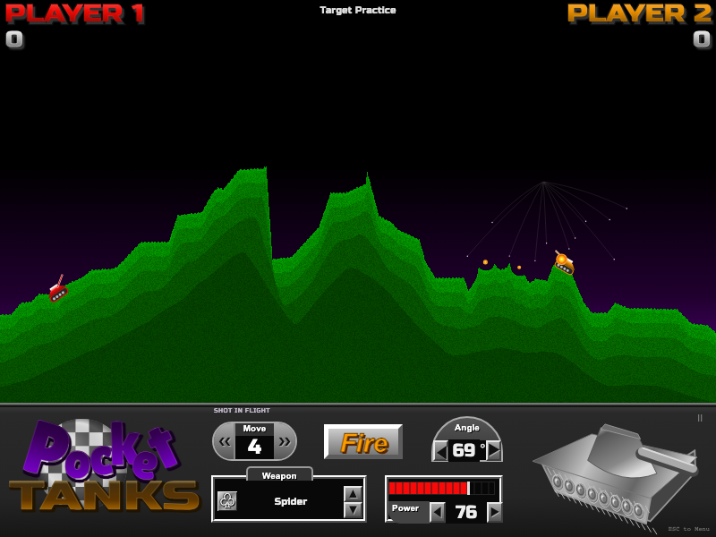

# Pocket Tanks · Web fan remake

A complete, free browser artillery game inspired by **Pocket Tanks (2001)**. Draft ten weapons, estimate your angle and power, and reshape the hills over ten volleys. Play against a friend on one device, challenge the CPU, or experiment with the unlimited arsenal in target practice.

**[Play in your browser](https://yagyesh-bobde.github.io/pocket-tanks/)** · **[Visual comparison report](https://yagyesh-bobde.github.io/pocket-tanks/comparisons/)** · [Research and source attribution](docs/RESEARCH.md)



This is an independent fan project, not affiliated with or endorsed by Blitwise Productions. Pocket Tanks and its game identity belong to Blitwise. All game code, tank illustrations, terrain rendering, effects, and sound synthesis here are newly made. Please support [the original game](https://www.blitwise.com/pocket-tanks).

## Run

Node.js **22.12+** (or 24+) and npm are required.

```sh
npm ci
npm run dev -- --host 127.0.0.1 --port 5180
```

Open http://127.0.0.1:5180. For a production build:

```sh
npm run build
npm run preview
```

Vite uses relative asset paths, so `dist/` can be served from a subdirectory, including GitHub Pages. No backend, account, API key, paid service, or external font request is needed.

## How to play

1. Choose **1 Player**, **2 Players**, or **Target Practice**. Set names and tank colours. The computer has Easy, Normal, and Hard settings.
2. In the weapon shop, alternate picking from twenty randomly selected weapons until each player has ten. Duplicates are allowed. **Random** distributes the remaining choices.
3. Choose a weapon, set the angle and power, and fire. 0° points right, 90° up, 180° left; angles through 359° let you dig downward. Power ranges from 0–100.
4. Hits on the opponent add points to the shooter. Self-hits subtract points. Tanks stay in play throughout the match. **The highest score after both players fire ten times wins.**
5. Each player has four moves for the entire match. A move travels 25 world pixels and is blocked by steep terrain, burial, or the other tank. Explosions remove dirt; dirt weapons can bury tanks. Shoot down or use Dirt Mover to clear a position.

Target practice alternates tanks with all thirty weapons and never consumes ammo. Options select mountains, valley, cliff, or plains, plus optional changing wind. Sound can be muted. The pause menu offers resume, restart, and main menu. Completed matches include a shot-by-shot scorecard, replay, and a new-match option.

## Controls

| Action | Mouse / touch | Keyboard |
| --- | --- | --- |
| Aim | Angle arrows or value; tap the battlefield | Left increases angle; Right decreases |
| Power | Red slider, arrows, or value | Up increases; Down decreases |
| Fine / coarse changes | Single arrow taps | Hold Shift for steps of 5 |
| Select weapon | Weapon box / arsenal, arrows; phone selector | A previous, Z next |
| Fire | Fire button | Space |
| Move | Move arrows; phone Move buttons | Comma left, period right |
| Pause / close | Pause button | Escape |
| Sound | Sound button | M |

Phones have an additional large touch dock below the classic game panel. Fullscreen is available where supported. Name fields, weapon choices, and controls have accessible labels and keyboard focus states. Saved matches resume between turns after reloading; preferences and the five highest completed match records stay in this browser's local storage. Nothing is sent to a game server.

## Arsenal

All **thirty original shareware weapon types** have distinct implementations; exact proprietary physics and damage tuning are not claimed.

| Weapons | Implemented behavior |
| --- | --- |
| Single Shot, Big Shot | Different blast radii and direct-hit scores: 60 / 30 |
| 3 Shot, 5 Shot | Simultaneous ballistic spreads |
| Jackhammer | Five vertical rebound blasts |
| Heatseeker | Steers toward a nearby opponent |
| Tracer | Five harmless test shots with angle-offset labels |
| Pile Driver | Successive downward blasts |
| Dirt Mover | Immediate directional excavation cone |
| Crazy Ivan | Proximity fragmentation with varied velocities |
| Spider | Proximity web of downward bombs |
| Sniper Rifle | Tiny hit zone, 100-point precision shot, no crater |
| Magic Wall | Grows a narrow vertical dirt wall |
| Dirt Slinger, Dirtball | Large dirt mound / smaller circular mound |
| Zapper | Proximity electrical strike |
| Napalm | Burning particles flow downhill and score bounded repeated hits |
| Hail Storm | 160 bouncing, flowing ice pellets |
| Ground Hog, Worm, Homing Worm | Straight, upward-curving, and enemy-seeking underground routes |
| Skipper | Four surface bounces before detonation |
| Chain Reaction | Timed explosions around the landing point |
| Pineapple | Proximity radial fragmentation |
| Firecracker | Small blasts spread horizontally in both directions |
| Homing Missile | Stops horizontally over a target and drops |
| Tommy Gun | Ten rapid ballistic bullets |
| Mountain Mover | Very large excavation with zero damage |
| Scatter Shot | Five upward shells on landing |
| Cruiser | Follows terrain, including uphill, before exploding |

## Tests and reproducible screenshots

```sh
npm test
npx playwright install chromium
npm run test:browser
# With the dev server running:
npm run capture
```

The engine suite checks deterministic terrain/drafts, swept collision, scoring, self-hit penalties, burial, craters, movement charges, weapon consumption, all thirty weapon resolutions, bounded liquid damage, real underground travel, CPU trajectories, unlimited practice, and full match termination. Browser tests exercise setup, alternating draft picks, input controls, keyboard fire, pause/help, all twenty shots, results/replay, CPU turns, persistence, and mobile controls. Browser tests accelerate simulation while waiting for shots; normal play runs at a fixed 120 Hz with real-time rendering.

The [comparison report](docs/comparisons/index.html) keeps before/after images, all six attributed reference pairs, an explicit weighted visual rubric, and subjective per-frame scores. Results and mobile images have no original reference and are unscored. See [the research record](docs/RESEARCH.md) for capture methodology and sources.

## Design and limits

- Browser Canvas 2D and accessible HTML controls; no game framework or backend.
- Seeded height-map terrain, fixed-step gravity and wind, swept projectile collision, blast falloff, and independently simulated effects.
- Terrain is a height map: unsupported dirt collapses rather than preserving hollow caves or overhangs. Burial remains meaningful because tanks do not teleport to the top of newly added dirt.
- This recreates the classic play loop, not its proprietary engine. Effect counts, point falloff, tank knockback, individual art, fonts, and CPU difficulty differ. No expansion packs, network/LAN multiplayer, original soundtrack, or exhaustive original options are included.
- Large custom lettering and geometric tank art approximate the reference style; they do not reproduce the original assets pixel for pixel. The report's ≥8 visual scores are the author's subjective frame-level assessment, not an independent certification.
- Current Chromium, Firefox, and Safari are the intended browsers. Automated UI verification currently runs on Chromium.

## License and credits

Original code and original artwork: [MIT](LICENSE). Bundled fonts **Russo One** and **Lilita One**: SIL Open Font License, with notices under [docs/licenses](docs/licenses/). Blitwise's reference screenshots and their excerpts in comparison PNGs remain copyrighted by Blitwise and are excluded from the MIT license; they appear only in attributed comparison documentation. The game does not load those screenshots.

Rules and weapon behavior were researched from Blitwise, Sao Li Zhou's 2003 GameFAQs FAQ, and Gerarge's Weapon Info guide. Full links and distinctions between observed facts and reconstruction choices are in [docs/RESEARCH.md](docs/RESEARCH.md).
