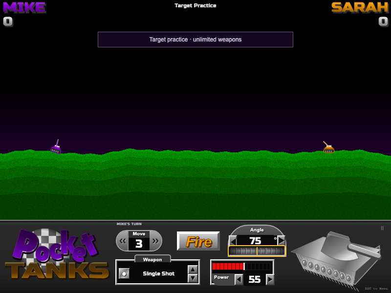

# Pocket Tanks · Web fan remake

A complete, free browser artillery game inspired by **Pocket Tanks (2001)**. Draft ten weapons, estimate your angle and power, and reshape the hills over ten volleys. Play against a friend on one device or two devices with a room code, challenge the CPU, or experiment with the unlimited arsenal in target practice.

This repository is **public and open source under the MIT license**. Anyone can browse the code, clone it, fork it, or host their own copy. The published game is free to play and needs no account or installation.

**[Play in your browser](https://yagyesh-bobde.github.io/pocket-tanks/)** · **[Movement / multiplayer captures](https://yagyesh-bobde.github.io/pocket-tanks/updates/)** · **[Visual comparison report](https://yagyesh-bobde.github.io/pocket-tanks/comparisons/)** · [Research and source attribution](docs/RESEARCH.md)



## What is included

- Local two-player matches, three CPU difficulty levels, and unlimited target practice.
- Two-device room-code play with alternating weapon draft, synchronized terrain and scores, reconnect, and rematch.
- Thirty mechanically distinct weapons, destructible terrain, ten volleys, and four moves per tank.
- Animated driving with tread motion, dust, engine audio, and optional supported-device vibration.
- A draggable and scrollable angle wheel, live turret updates, and keyboard/mouse/touch controls.

Validation covers **34 automated tests**: 20 engine tests, 5 analytics tests, 6 browser tests, and 3 WebRTC tests. It includes 144 prediction-versus-impact physics cases, a complete two-client match, reconnects, and a real-time 160-particle Hail Storm. The deployment workflow runs these checks before publishing to GitHub Pages.

This is an independent fan project, not affiliated with or endorsed by Blitwise Productions. Pocket Tanks and its game identity belong to Blitwise. All game code, tank illustrations, terrain rendering, effects, and sound synthesis here are newly made. Please support [the original game](https://www.blitwise.com/pocket-tanks).

## Run

Node.js **22.12+** (or 24+) and npm are required.

```sh
git clone https://github.com/yagyesh-bobde/pocket-tanks.git
cd pocket-tanks
npm ci
npm run dev -- --host 127.0.0.1 --port 5180
```

Open http://127.0.0.1:5180. For a production build:

```sh
npm run build
npm run preview
```

Vite uses relative asset paths, so `dist/` can be served from a subdirectory, including GitHub Pages. Local play needs no account, backend, API key, or external font request. Online / Wi-Fi play uses the free PeerJS signaling service and STUN to establish a direct WebRTC data channel.

## How to play

1. Choose **1 Player**, **2 Players** (one device), **Online / Wi-Fi** (two devices), or **Target Practice**. Set names and tank colours. The computer has Easy, Normal, and Hard settings.
2. In the weapon shop, alternate picking from twenty randomly selected weapons until each player has ten. Duplicates are allowed. **Random** distributes the remaining choices.
3. Choose a weapon, set the angle and power, and fire. 0° points right, 90° up, 180° left; angles through 359° let you dig downward. Power ranges from 0–100.
4. Hits on the opponent add points to the shooter. Self-hits subtract points. Tanks stay in play throughout the match. **The highest score after both players fire ten times wins.**
5. Each player has four moves for the entire match. A move drives 25 world pixels over 0.7 seconds, follows the terrain, and is blocked by steep terrain, burial, or the other tank. Treads, dust, engine audio, and optional supported-device vibration provide feedback; shots wait until movement finishes. Explosions remove dirt; dirt weapons can bury tanks. Shoot down or use Dirt Mover to clear a position.

Target practice alternates tanks with all thirty weapons and never consumes ammo. Options select mountains, valley, cliff, or plains, plus optional changing wind. Sound can be muted. The pause menu offers resume, restart, and main menu. Completed matches include a shot-by-shot scorecard, replay, and a new-match option.

## Controls

| Action | Mouse / touch | Keyboard |
| --- | --- | --- |
| Aim | Drag / scroll the ridged angle thumbwheel; edit the live value; drag on the battlefield | Left increases angle; Right decreases |
| Power | Red slider, arrows, or value | Up increases; Down decreases |
| Fine / coarse changes | Single arrow taps | Hold Shift for steps of 5 |
| Select weapon | Weapon box / arsenal, arrows; phone selector | A previous, Z next |
| Fire | Fire button | Space |
| Move | Move arrows; phone Move buttons | Comma left, period right |
| Pause / close | Pause button | Escape |
| Sound | Sound button | M |

Phones have an additional large touch dock below the classic game panel. Fullscreen is available where supported. Name fields, weapon choices, and controls have accessible labels and keyboard focus states. Saved matches resume between turns after reloading; preferences and the five highest completed match records stay in this browser's local storage. Network rooms exchange names, commands, and match state with the other player; local match state remains on the device. The published site also sends anonymous visitor and basic game-activity statistics as described below.

## Two-device play

1. On both devices, open [the game](https://yagyesh-bobde.github.io/pocket-tanks/) and choose **Online / Wi-Fi**. No installation or account is needed.
2. Enter your names. One player chooses **Create Room** and shares the six-character code or **Copy Invite Link**. The other chooses **Join Room**.
3. The host chooses **Start Match**. Draft alternately, then each player controls only their own turns. The host may randomize the remaining draft and start a rematch.

Keep the host tab open and visible. The host simulates the game; the guest receives terrain, scores, projectiles, and movement. Opening a help/menu overlay does not pause network play. A lost connection holds the match; the guest can choose **Reconnect** from the original tab. Reloading or closing the host loses that room; reloading the guest loses its reserved-seat token. Create a new room in those cases. Network games are not stored as resumable solo saves.

The published version needs internet access for PeerJS cloud signaling, including when both players use the same Wi-Fi. Gameplay then travels directly between browsers. Guest Wi-Fi isolation, firewalls, some VPNs, and restrictive NATs can prevent connection; there is no TURN relay or guarantee across every internet connection. Connection failures show retry/edit controls. Play on the same ordinary Wi-Fi for the easiest connection.

For **LAN signaling without the public broker**, on a machine accessible to both players:

```sh
npm ci
npm run signal
# In another terminal, replace the example with this machine's LAN IP:
VITE_PEER_HOST=192.168.1.20 npm run dev -- --host 0.0.0.0 --port 5180
```

Open `http://192.168.1.20:5180` on both devices and use room codes normally. Permit TCP ports 5180 and 9000 on that machine. The server command runs the upstream PeerJS signaling server; it does not store game state. `VITE_PEER_PORT` (default `9000`), `VITE_PEER_PATH` (default `/pocket-tanks`), and `VITE_PEER_SECURE=true` allow a separately hosted HTTPS broker. These settings are chosen at Vite startup/build time, not by visitors to the published page. Local ICE candidates can connect on an ordinary LAN without STUN access. Devices/browsers that restrict WebRTC on HTTP need HTTPS hosting.

Vibration is optional in **Options**. It uses the browser Vibration API when supported (typically Android); iOS Safari and many desktop browsers do not expose it. Movement animation and sound still work there.

## Arsenal

All **thirty original shareware weapon types** have distinct implementations; exact proprietary physics and damage tuning are not claimed.

| Weapons | Implemented behavior |
| --- | --- |
| Single Shot, Big Shot | Different blast radii and direct-hit scores: 60 / 30 |
| 3 Shot, 5 Shot | Simultaneous ballistic spreads |
| Jackhammer | Five vertical rebound blasts |
| Heatseeker | Steers toward a nearby opponent |
| Tracer | Five harmless test shots with angle-offset labels |
| Pile Driver | Successive downward blasts |
| Dirt Mover | Immediate directional excavation cone |
| Crazy Ivan | Proximity fragmentation with varied velocities |
| Spider | Proximity web of downward bombs |
| Sniper Rifle | Tiny hit zone, 100-point precision shot, no crater |
| Magic Wall | Grows a narrow vertical dirt wall |
| Dirt Slinger, Dirtball | Large dirt mound / smaller circular mound |
| Zapper | Proximity electrical strike |
| Napalm | Burning particles flow downhill and score bounded repeated hits |
| Hail Storm | 160 bouncing, flowing ice pellets |
| Ground Hog, Worm, Homing Worm | Straight, upward-curving, and enemy-seeking underground routes |
| Skipper | Four surface bounces before detonation |
| Chain Reaction | Timed explosions around the landing point |
| Pineapple | Proximity radial fragmentation |
| Firecracker | Small blasts spread horizontally in both directions |
| Homing Missile | Stops horizontally over a target and drops |
| Tommy Gun | Ten rapid ballistic bullets |
| Mountain Mover | Very large excavation with zero damage |
| Scatter Shot | Five upward shells on landing |
| Cruiser | Follows terrain, including uphill, before exploding |

## Tests and reproducible screenshots

```sh
npm test
npx playwright install chromium
npm run test:browser
npm run test:network
# With the dev server running:
npm run capture
# Also captures live movement and two clients via public signaling:
node scripts/capture-update.mjs
```

The engine suite checks deterministic terrain/drafts, swept collision, scoring, self-hit penalties, burial, craters, movement charges, weapon consumption, all thirty weapon resolutions, bounded liquid damage, real underground travel, CPU trajectories, unlimited practice, and full match termination. Browser tests exercise setup, alternating draft picks, input controls, keyboard fire, pause/help, all twenty shots, results/replay, CPU turns, persistence, and mobile controls. Browser tests accelerate simulation while waiting for shots; normal play runs at a fixed 120 Hz with real-time rendering. A separate WebRTC suite starts a local signaling broker and checks two isolated clients through a full match, reconnect, seat rejection, rematch, and a real-time 160-particle Hail Storm. Every weapon’s sampled network snapshots are checked against a 48 KiB budget. Render-only state and the binary data channel’s automatic chunking keep dense effects within transport limits. Physics checks include analytic gravity/wind, 144 prediction-versus-impact cases, continuous movement, and narrow path obstructions.

The [comparison report](docs/comparisons/index.html) keeps before/after images, all six attributed reference pairs, an explicit weighted visual rubric, and subjective per-frame scores. Results and mobile images have no original reference and are unscored. See [the research record](docs/RESEARCH.md) for capture methodology and sources.

## Analytics

The published game uses **PostHog** in the existing Storyowl project. The private [Pocket Tanks dashboard](https://us.posthog.com/project/68409/dashboard/2331682) contains visitors, pageviews, sessions, daily traffic, new/returning browsers, referrers, countries, devices, browsers, modes, match completions, and connected multiplayer browsers. Every chart filters `app=pocket-tanks` and `environment=production` to separate this game from other apps in that project.

Visitors are anonymous browser IDs, **not identified people**. New/returning means first/subsequent page loads in a browser with local storage available; it is not cross-device identity or a retention cohort. Session counts use PostHog session IDs. Approximate location and browser/device/source information accompany events. Game events are `pt_mode_selected`, `pt_screen_view`, `pt_match_started`, `pt_match_resumed`, `pt_match_completed`, and `pt_room_connected`. Match and room counts are per participating browser; an online match can contribute two events.

Player names, room codes, form values, and save data are excluded. URL query strings/fragments are stripped before sending. Automatic click capture, recordings, heatmaps, surveys, exceptions, and performance capture are disabled. Analytics honors Do Not Track, Global Privacy Control, and the **Disable analytics** footer button. The [privacy page](https://yagyesh-bobde.github.io/pocket-tanks/privacy.html) explains collection and lets a browser opt back in. Analytics failures do not block the game.

Only the exact published game host/path sends analytics. Localhost, LAN builds, other forks, and `?review=1` capture fixtures are excluded. Development/tests need no key and do not send traffic. GitHub Actions builds the production client using repository variables `VITE_POSTHOG_KEY` (the **public project ingestion token**, never a personal API key) and `VITE_POSTHOG_HOST` (`https://us.i.posthog.com`). Configure your own public project token and change `productionVisitor` in `src/analytics.js` when hosting a fork. Keep personal API keys and account/session credentials out of frontend code and repository variables.

## Design and limits

- Browser Canvas 2D and accessible HTML controls; no game framework or hosted game backend. PeerJS is loaded only for multiplayer.
- Seeded height-map terrain, shared exact gravity/wind integration at a fixed step, swept projectile collision, blast falloff, and independently simulated effects.
- Terrain is a height map: unsupported dirt collapses rather than preserving hollow caves or overhangs. Burial remains meaningful because tanks do not teleport to the top of newly added dirt.
- This recreates the classic play loop, not its proprietary engine. Effect counts, point falloff, tank knockback, individual art, fonts, and CPU difficulty differ. No expansion packs, original soundtrack, or exhaustive original options are included. Network rooms are for two players and depend on the host remaining open; they do not provide matchmaking or persistent accounts.
- Large custom lettering and geometric tank art approximate the reference style; they do not reproduce the original assets pixel for pixel. The report's ≥8 visual scores are the author's subjective frame-level assessment, not an independent certification.
- Current Chromium, Firefox, and Safari are the intended browsers. Automated UI verification currently runs on Chromium.

## License and credits

Original code and original artwork: [MIT](LICENSE). Bundled fonts **Russo One** and **Lilita One**: SIL Open Font License, with notices under [docs/licenses](docs/licenses/). PeerJS and PostHog, with their bundled runtime dependencies, retain their MIT/BSD/Apache notices there as well. Blitwise's reference screenshots and their excerpts in comparison PNGs remain copyrighted by Blitwise and are excluded from the MIT license; they appear only in attributed comparison documentation. The game does not load those screenshots.

Rules and weapon behavior were researched from Blitwise, Sao Li Zhou's 2003 GameFAQs FAQ, and Gerarge's Weapon Info guide. Full links and distinctions between observed facts and reconstruction choices are in [docs/RESEARCH.md](docs/RESEARCH.md).
